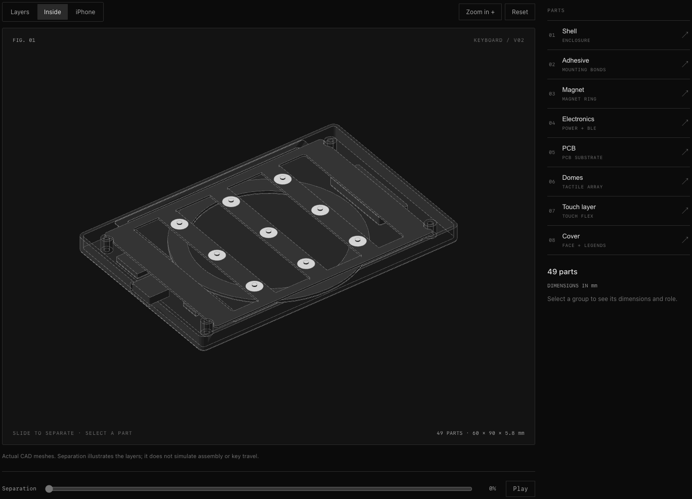

# dboard-3d

A nine-zone touch keyboard accessory with parametric CAD, 3D models, an interactive Anatomy viewer, and an iPhone 16 size reference.



## Design

- 60 × 90 × 5.8 mm card with a continuous flexible touch surface.
- Nine tactile dome zones, rather than mechanical switches.
- Centered Ø57 mm magnet-ring envelope.
- Opaque smooth white touch face, monochrome dot-matrix legends and visible internal structure.
- Separate shell, cover, PCB, domes, battery, electronics, magnets, fasteners and legends.

This is a review prototype. Resin-print thin features need revision; FDM and molding warnings remain. Wireless charging, phone fit, key force and electrical functionality are unverified.

## HTML and formats

[Single-file anatomy HTML](outputs/keyboard-anatomy-v05.html) includes Layers, Inside and iPhone with embedded SVG, styles and scripts. Product has been removed from the website. Diagram viewing is self-contained; PDF/model download links need internet.

[Additional 3D formats](outputs/exports/keyboard-white-formats-v05.zip): clean white GLB, glTF + BIN, OBJ + MTL, FBX, STL and PLY, plus the existing engineering STEP. Round-trip bounds were checked. Mesh coordinates for OBJ/STL/PLY are millimeters; the STEP remains the original 5.8 mm engineering review model.

## View

Live viewer: <https://dboard-3d.vercel.app/>. Vercel routes the homepage to the checked-in viewer and keeps model download links working through `vercel.json`. No build command or framework is required.

Download and extract [the complete viewer package](outputs/anatomy-viewer-v02.zip), then open `anatomy/index.html`. The viewer runs offline and includes **Layers**, **Inside**, and **iPhone** views, part selection, zoom, pan, and a white-only interface.

Or serve the checked-out files:

```sh
python3 -m http.server 8766 --bind 127.0.0.1 --directory outputs
```

Open <http://127.0.0.1:8766/anatomy/index.html>. GitHub's HTML file preview displays source; it does not run the viewer.

## White revision

The latest direction is a solid white opaque body and smooth touch face with visible neutral-grey legends. [White appearance preview](outputs/renders-white/previews/01-hero-v05.png) · [White GLB](outputs/exports/white-v05/keyboard-white-v05.glb) · [Manufacturer brief](outputs/spec-white/design-brief-v05.txt).

The new thickness target is approximately 3 mm, referenced to the PLAUD Note published 2.99 mm device thickness. Current CAD and appearance previews remain 5.8 mm; the internal stack-up requires redesign and review.

## Renders

Four headless Blender / Cycles product shots at 3000 px: [Hero](outputs/renders-white/01-hero-v05.png), [Top](outputs/renders-white/02-top-v05.png), [Exploded](outputs/renders-white/03-exploded-v05.png), and [Attached](outputs/renders-white/04-attached-v05.png).

[Editable Blender scenes](outputs/renders-white/keyboard-studio-v05.blend) · [Render notes](outputs/renders-white/README.txt). Hangul legends are separate dot objects.

## Chinese PDF

[Annotated anatomy PDF](outputs/pdf/keyboard-anatomy-zh-v05.pdf): two A4 pages with the website CAD figure, numbered Chinese component notes, dimensions and manufacturer validation requirements. The PDF button on the live viewer opens this document.

Rebuild with `python3 visual/export_pdf_source.py` then `python3 visual/build_pdf.py` (ReportLab, svglib, lxml and fontTools; tested with the macOS Heiti SC font).

## Models

| File | Purpose |
|---|---|
| [Keyboard GLB](outputs/exports/hangul-card-opaque-v04.glb) | 3D viewing and Blender import |
| [Keyboard STEP](outputs/exports/hangul-card-review-v02.step) | CAD editing and engineering review |
| [Keyboard beside iPhone](outputs/exports/iphone16-keyboard-beside-v02.glb) | Size comparison |
| [Keyboard on iPhone](outputs/exports/iphone16-keyboard-attached-v02.glb) | Illustrative back placement |
| [CAD source package](outputs/phase-1/phase-1-source-v02.zip) | Standalone keyboard source and checks |

CAD uses millimeters and +Z up. GLB uses standard glTF meters. The iPhone 16 body uses Apple's published 71.6 × 147.6 × 7.8 mm dimensions; camera details and corner radii are schematic. Attached placement is offset 12 mm downward and does not establish MagSafe alignment.

## Source

```text
src/hangul_card.py          Parametric keyboard and named assembly parts
src/phone_comparison.py     iPhone reference and comparison assemblies
checks/clearance.py         Exact clearance checks and planted-fault tests
checks/shell-spec.json      Independent screw-hole and boss requirements
checks/anatomy_data.py      CAD surface meshes for visualization
visual/build.mjs           Anatomy viewer builder
visual/vendor/anatomy/     MIT-licensed Anatomy components
outputs/                   Models, viewers, screenshots and review evidence
```

### CAD

Tested with `cad 0.11.18`, `agentcad 0.8.1` and Python 3.11:

```sh
uv tool install 'cad==0.11.18'
uv tool install --python 3.11 'agentcad==0.8.1'
cad server start
cad run src/hangul_card.py
cad run src/phone_comparison.py
cad run checks/clearance.py
```

Use the model IDs printed by your own run. IDs depend on the absolute script path, so IDs recorded in review reports are local references.

### Viewer

Requires Node.js 20.10 or later. The checked-in mesh data allows rebuilding without CAD tools:

```sh
node visual/build.mjs
node visual/build.mjs --light
```

After changing the CAD, regenerate its visualization data first:

```sh
cad run checks/anatomy_data.py
```

## Validation

- Keyboard static interference and specified clearance checks pass.
- Independent STEP validity, screw-hole and boss checks pass.
- Both iPhone comparison GLBs imported into Blender with their expected object counts and bounds.
- English viewer controls, white-only layout, mobile layout, keyboard navigation, zoom/pan and reduced motion were checked in a browser.
- Resin printing checks **fail** on thin features; FDM and injection-molding checks retain warnings.

See [viewer notes](outputs/anatomy/README.md), [CAD review](outputs/phase-1/REVIEW-v02.md), and the raw JSON reports under `outputs/`. Earlier specification and CAD review documents preserve the original Chinese review history; the viewer and current project README are English.

The Anatomy adapter uses actual CAD meshes. Its presentation animation is not a physical disassembly simulation and does not claim to pass Anatomy's primitive/SDF geometry audit.

## License

MIT. Anatomy components are from [neekitalian/anatomy](https://github.com/neekitalian/anatomy), pinned to `1482e8469b0a9e0d8cc18ea2740a01423d29ae80`; their original copyright and MIT license are retained in [visual/vendor/anatomy/LICENSE](visual/vendor/anatomy/LICENSE). No flowful-ai/cad-skill code is included.
